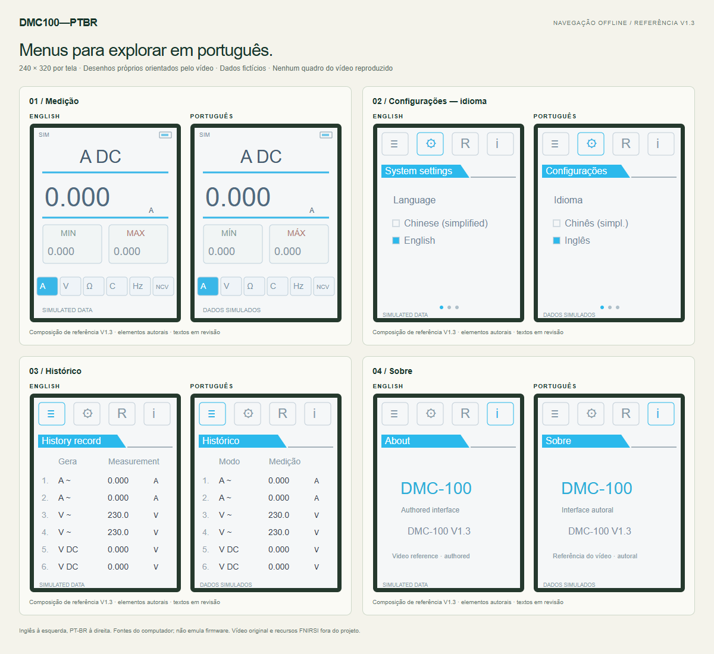

# DMC100-PTBR 🇧🇷

Projeto comunitário e **não oficial** para pesquisar a tradução da interface do multímetro/alicate amperímetro **FNIRSI DMC-100** para português do Brasil.

> **STATUS: PESQUISA / PRÉ-ALFA. NÃO EXISTE FIRMWARE PT-BR VALIDADO PARA INSTALAÇÃO.** Não grave modificações experimentais em aparelhos usados para medições elétricas. Este repositório contém somente ferramentas de análise estática e documentação.

## Objetivos

- Catalogar os textos e menus das versões de firmware do DMC-100.
- Traduzir mensagens e avisos, preservando a terminologia elétrica e as unidades.
- Investigar fontes, imagens da interface e limites de armazenamento dos textos.
- Criar verificadores de firmware **somente leitura**, com testes automatizados.
- Exigir validação independente e testes de segurança antes de qualquer possível firmware instalável.

Equipamento de referência: **DMC-100 V1.3**. A amostra V1.4 foi analisada offline: [identificação por SHA-256, strings e fontes](docs/ANALISE_V14_BINARIO.md). Isso não demonstra compatibilidade com a unidade V1.3.

## Estado

| Etapa | Situação |
|---|---|
| Estudo e fontes | Iniciado |
| Catálogo PT-BR | Rascunho |
| Inspeção estática com testes | Disponível |
| Validar offsets no arquivo V1.4 analisado | 14/14 textos com NUL confirmados |
| Mapear JPEGs/fontes | Oito tabelas de fontes; imagens externas pendentes |
| Simulador visual offline | Disponível, autoral, 240 × 320; fontes reais não emuladas |
| Testes metrológicos e revisão independente | Pendente |
| Firmware instalável | **Indisponível** |

## Executar o verificador local

Use **somente uma cópia obtida legitimamente** do firmware; não publique o arquivo nem inclua backups do aparelho no Git.

```bash
python -m src.dmc100_ptbr.inspect caminho/para/APP_DMC-100_V1.4_250524.bin
python -m src.dmc100_ptbr.inspect caminho/para/APP_DMC-100_V1.4_250524.bin --json
python -m unittest discover -s tests -v
```

O programa apenas lê o arquivo, calcula SHA-256, confere o tamanho e compara textos com o catálogo. Os offsets foram confirmados na amostra identificada no relatório; coincidências em outro arquivo não atestam autenticidade, segurança ou compatibilidade.

O código de saída 0 do inspetor exige tamanho reportado e todos os textos com terminador NUL; significa apenas coincidência com esse catálogo. `matches` continua indicando comparação do trecho; `nul_terminated_matches` é a verificação completa. O antigo campo `found_hex` foi removido para não expor bytes arbitrários do arquivo em relatórios.

### Pesquisa estrutural e simulação offline

Coloque uma cópia legítima em `private/firmware/APP_DMC-100_V1.4_250524.bin` (pasta ignorada pelo Git), preservando o nome recebido e registrando separadamente origem, data, tamanho e SHA-256. Esse é o nome da referência comunitária, não um identificador autenticado do fabricante. Não use o nome como prova de versão.

```bash
python -m src.dmc100_ptbr.analyze private/firmware/APP_DMC-100_V1.4_250524.bin
python -m src.dmc100_ptbr.layout --width 220 --cell 8
python -m src.dmc100_ptbr.layout --width 220 --cell 12
```

`analyze` imprime metadados JSON de vetores candidatos, duplicatas, marcadores JPEG, referências a recursos, candidatos de texto e entropia. Também procura referências ADR Thumb T1 e aplica o perfil de fontes/base apenas ao SHA-256 observado. Não extrai imagens nem publica textos arbitrários. Revise manualmente antes de compartilhar qualquer relatório. `layout` simula orçamento de bytes e largura monoespaçada assumida, sem ler firmware; não emula a fonte ou o equipamento. Os parâmetros 220/8/12 são cenários, não medidas confirmadas.

Os três testes de integração com a amostra privada só rodam quando `DMC100_V14_PATH` aponta explicitamente para o arquivo local. A CI executa 24 testes sintéticos e ignora os três privados; nunca baixa firmware. Veja os comandos e resultados no relatório do binário.

## Simulador visual offline

**Português (Brasil) já é selecionável no menu do protótipo:** Configurações → Idioma → Português (BR) * → Confirmar idioma. Chinês e inglês são mantidos. É uma proposta offline; não acrescenta idioma ao equipamento. [Estado da seleção e próximos passos](docs/SELECAO_PTBR.md).

Abra `simulator/index.html` no navegador, mantendo os arquivos da pasta juntos. Não exige instalação nem internet. Navegue por Medição, Histórico, Configurações, Restaurar e Sobre em inglês/PT-BR. A composição orientada pelo vídeo privado V1.3 usa desenhos próprios, com geometria 240 × 320 e leituras fictícias. Botões e configurações atuam só no estado da página. Não emula firmware nem carrega seus recursos. A bancada anterior, com fontes, abreviações, acentos e cenários de aviso, continua em `simulator/lab.html`.

O catálogo básico registra 15 rótulos confirmados em 20 ocorrências; a navegação amplia para 16 em 21, além de rótulos do vídeo e autorais com evidência explícita. Exporte JSON ou SVG. [Manual e testes](simulator/README.md) · [Vídeo V1.3, comparação com V1.4 e limitações](docs/VIDEO_V13_NAVEGACAO.md).



## Documentação

- [Estudo técnico](docs/ESTUDO_TECNICO_INICIAL.md)
- [Auditoria, viabilidade e resultados dos testes](docs/VIABILIDADE_V14.md)
- [Análise do binário V1.4: hash, base de carga e fontes](docs/ANALISE_V14_BINARIO.md)
- [Simulador visual e resultados da fase 02](docs/SIMULADOR_VISUAL.md)
- [Dependências de recursos gráficos externos](docs/RECURSOS_EXTERNOS.md)
- [Referência privada V1.3 e navegação autoral](docs/VIDEO_V13_NAVEGACAO.md)
- [Roteiro de desenvolvimento](docs/ROADMAP.md)
- [Traduções preliminares](docs/TRADUCOES.md)
- [Segurança técnica](docs/SEGURANCA.md)
- [Fontes e créditos](docs/FONTES.md)
- [Como contribuir](CONTRIBUTING.md)
- [Apoio voluntário](APOIE.md)

## Apoio voluntário

Quando houver canal de recebimento definido, interessados poderão contribuir opcionalmente com **R$ 5** para manutenção e testes. Não é compra, taxa de acesso ou garantia de entrega. Não há arrecadação ativa. O código e a documentação autoral permanecerão acessíveis sem pagamento.

## Direitos e independência

Sem vínculo com a FNIRSI. Marcas FNIRSI e DMC-100 pertencem aos titulares. A licença MIT vale **apenas para código e documentação autorais aqui publicados**, não para firmware, imagens, documentação ou outros ativos de terceiros. Não redistribuímos binários proprietários ou derivados sem a autorização necessária.

**Leia [SECURITY.md](SECURITY.md) antes de contribuir com alterações técnicas.**
