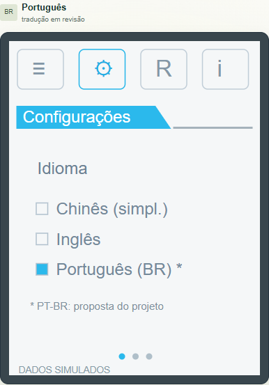

# Português (Brasil) selecionável — proposta offline

Data: 15/11/2026. Base: PR #7. A preferência de produto é uma interface com chinês, inglês e Português (Brasil) selecionáveis. A terceira opção está pronta no **simulador**, não no firmware do aparelho.

## Como testar

Abra `simulator/index.html`. Acesse **Configurações → Idioma → Português (BR) * → Confirmar idioma**. Também funciona por MODE/setas: entre na subpágina e nas opções, escolha PT-BR e pressione MODE para pedir confirmação e novamente para aplicar. Cancelar/Voltar preserva o idioma anterior. Sair da tela sem confirmar também não aplica a escolha.

Ao confirmar, a visualização acompanha o idioma nas telas de histórico, configurações, restauração e Sobre. O seletor externo continua permitindo comparar inglês/PT-BR ou inspecionar uma prévia sem alterar a escolha do modelo. As opções chinesa e inglesa não foram removidas. O asterisco indica que **Português (Brasil) é uma proposta, inexistente na amostra original examinada**.

A prévia chinesa usa traduções próprias, não revisadas nem extraídas do fabricante. Depende de fontes CJK instaladas no computador; texto no DOM não garante glifo em todo sistema. Uma futura integração deve preservar os recursos chineses originais, não substituí-los por essa prévia.

A escolha permanece em memória, inclusive ao ligar/desligar o modelo. Recarregar a página volta ao estado inicial inglês. Não há escrita em flash, persistência no equipamento ou alteração do firmware.

## Integração real: trabalho ainda necessário

As referências estáticas mostram testes zero/não zero para selecionar chinês/inglês, além de atribuições dos dois valores. Apenas gravar um terceiro número pode continuar selecionando o ramo inglês ou produzir estados não previstos; não cria traduções, glifos ou recursos. Os IDs 0/1/2 de `navigation.js` são um contrato offline, não uma mudança em um campo do firmware.

Uma implementação real exige:

1. Mapear todos os consumidores do idioma: menus, inicialização, recursos, armazenamento e restauração. Preservar os dois idiomas existentes.
2. Definir despacho explícito de textos/recursos PT-BR, fallback para valores inválidos e compatibilidade com configurações antigas. Nenhum despachante embarcado foi produzido.
3. Resolver glifos/codificação. As tabelas examinadas não contêm as chaves dos acentos PT-BR; UTF-8 ou GBK isoladamente não resolvem o repertório.
4. Verificar alocações, duplicatas, referências, alinhamento, fontes e gráficos externos. Nenhum espaço livre foi comprovado.
5. Confirmar integridade, revisão de hardware, direitos, recuperação e revisão independente antes de qualquer mudança instalável.

Não está pronta uma imagem trilíngue nem demonstrado que adicionar o seletor preserve todas as funções sem alterações adicionais. Uma variante dedicada continua sendo alternativa de estudo se o terceiro idioma exigir custo/risco excessivo; essa alternativa não foi escolhida.

## Modelo e testes

`locales` preserva os IDs de referência 0/1 e acrescenta PT-BR como proposta. Escolhas pendente e aplicada são distintas. Cancelamento/saída não aplicam o idioma. Trocar idioma não altera leituras fictícias, histórico, unidade ou brilho. Reset local restaura padrões do modelo, inclusive inglês.

O catálogo passa a 38 entradas, mantendo os 16 rótulos/21 ocorrências confirmados. As novas mensagens e traduções chinesas são autorais, com evidência distinta do firmware.

Passaram localmente **26 testes Node e 13 Playwright/Chrome**, incluindo seleção dos três idiomas, confirmação/cancelamento, saída sem aplicar, retorno a inglês/chinês e invariância dos dados. A CI existente permanece sem acesso a firmware, vídeo ou quadros privados. O resultado remoto é registrado no PR.

Não foi modificado firmware, criado patch/fonte embarcada ou gerado arquivo instalável. Esta implementação restringe-se a texto, seleção e navegação no computador; nenhuma rotina de medição, calibração ou segurança foi portada.
