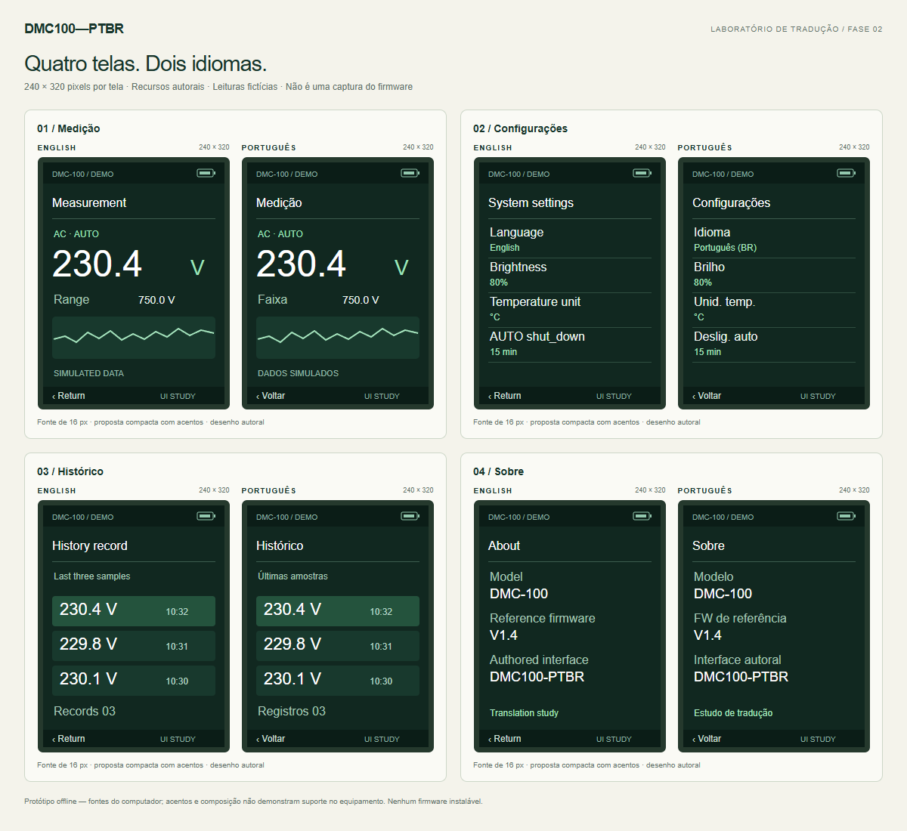
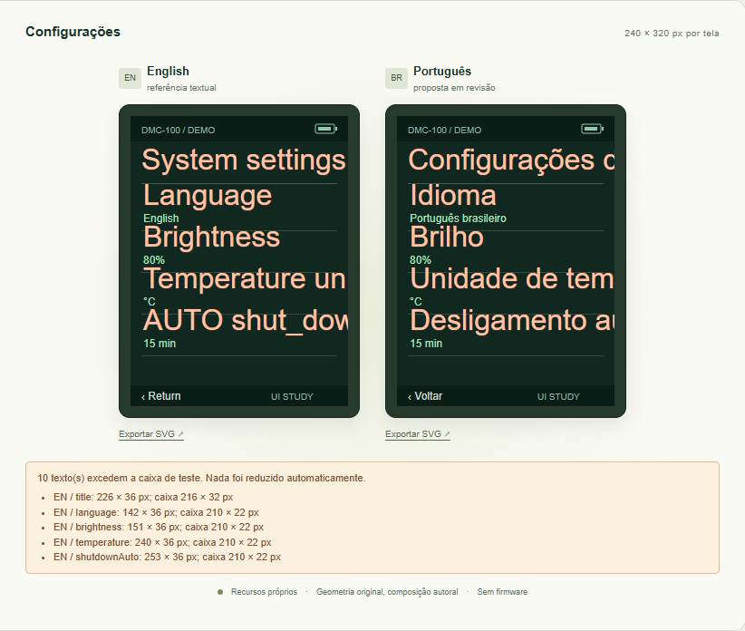

# Fase 02 — simulador visual autoral

Data: 15/11/2026. Base: PR #5, head `f589fe0`. O PR #5 passou por revisão final de código, diffs, testes e escopo. Seus 27 testes foram repetidos com a amostra privada, sem alteração de hash, e a CI já registrada passou nas quatro combinações. Não foram encontrados impedimentos para merge como ferramenta de pesquisa somente leitura; a recomendação foi publicada no PR. Nenhum merge foi efetuado. O novo PR parte dessa branch enquanto ela permanece aberta.

## Resultado

Simulador sem backend e sem dependências de runtime, aberto diretamente por `simulator/index.html`. Mostra Medição, Configurações, Histórico e Sobre em inglês/PT-BR lado a lado, além de três cenários de Avisos. Cada SVG tem dimensões intrínsecas e viewBox **240 × 320**, independentemente do zoom de apresentação. Os desenhos e a composição são autorais; não representam captura ou emulação fiel do firmware.

O [manual do simulador](../simulator/README.md) explica abertura offline, controles, exportações e testes. Nenhum arquivo do firmware, bitmaps ou fontes proprietárias está na aplicação.

## Catálogo e evidência

`simulator/catalog.js` é o catálogo canônico da interface visual: 25 entradas únicas. Quinze são rótulos ingleses confirmados na amostra V1.4, em **20 ocorrências com NUL**; dez são rótulos autorais de contexto, sem offsets, necessários para compor telas hipotéticas. Todas as propostas PT-BR permanecem em revisão. Não se afirma que o inventário cubra todo o executável.

Foram mantidas as duplicatas de Language, English e System settings e acrescentado Reset em `0x003DE4` e `0x00AE44`. O verificador privado do catálogo valida hash, os vinte textos/terminadores e preservação do original. Os catorze rótulos do inspetor anterior não foram alterados nesta fase. Range/Faixa e os títulos de modelo/versão são autorais e não ganham offsets inventados. A seleção Português (BR) no protótipo não significa que esse idioma exista no firmware.

As variantes são português completo, compacto com acentos e compacto sem acentos. Há exportação JSON com todas as ocorrências e evidência de origem; versões ASCII removem diacríticos do texto proposto, sem tocar símbolos/unidades fixos das amostras.

## Renderização e limitações

O modelo gera SVG com primitivas e texto. A interface usa `getBBox()` para comparar largura/altura renderizada com caixas declaradas e com os limites da tela. Não aplica redução automática, reticências ou aumento de viewport para esconder excessos. Os números e unidades das amostras são idênticos nos dois idiomas. Valores fixos não são cálculo metrológico; a curva é desenho ilustrativo.

São testados 12/16/24/32 px, Arial/sans-serif e Consolas/monospace com fallback local, grade e escalas de apresentação. A fonte numérica principal e alguns metadados têm tamanhos fixos; o seletor controla títulos/rótulos. No cenário compacto padrão de 16 px, as cinco telas passaram nas caixas declaradas do Chrome local. Isso é um resultado do navegador/fonte disponível, não do equipamento. O cenário completo de configurações a 32 px reporta dez excessos nas duas línguas:

O recorte ao limite de 240 px é intencional nesse teste. Os excessos são indicados em cor e no painel, não aceitos como layout final. As caixas são restrições de projeto autoral; não foram medidas em capturas da interface original. `getBBox()` não detecta toda colisão possível entre objetos. A revisão visual humana permanece necessária.

UTF-8 é apenas a codificação do protótipo/browser e dos relatórios de tamanho. A amostra real usa caminho ASCII/pares e não demonstrou suporte aos acentos PT-BR testados. Antialiasing, métricas, fontes de fallback, ícones e cores do navegador não reproduzem o LCD ou a renderização embarcada. Não foram copiados bitmaps nem ampliadas tabelas do firmware.

## Armazenamento

O painel calcula bytes UTF-8 normalizados em NFC, com/sem NUL, e compara com o comprimento original do texto analisado. Esse número não é slot alocado, espaço livre, mapa de ponteiros ou autorização de patch. Os rótulos completos podem caber visualmente e exceder o comprimento original: Configurações do sistema tem 26 bytes UTF-8 frente a 15 de System settings. Empréstimos de espaço entre duplicatas não são suportados ou assumidos.

Um framebuffer de 240 × 320 em RGB565 ocupa 153.600 bytes; RGBA no navegador ocupa 307.200 bytes por imagem, sem contar overhead. Esses buffers são do computador. Não se deduz que caibam na RAM reportada do MCU. Tabelas de fontes, páginas de configurações, bootloader, recurso JPEG externo e integridade precisam de análise própria. Não foi estimada RAM/flash livre com base no tamanho da aplicação.

As [dependências externas](RECURSOS_EXTERNOS.md) foram correlacionadas por família e chamadas. Medição e navegação têm dependências JPEG identificadas; histórico tem parte da cadeia pendente; Sobre não mostrou JPEG direto na rotina consultada. Todos esses elementos são substituídos por primitivas próprias no simulador.

## Testes e verificação

- Python: 27/27 testes passam quando os três privados opt-in são habilitados; CI mantém 24 aprovados e três ignorados, sem baixar firmware.
- Node: nove casos passam, incluindo renderização de 120 combinações, duplicatas/evidência, normalização e bytes, invariância de valores/unidades, estados inválidos, escape de texto e ausência de assets externos no SVG.
- Playwright/Chrome local: seis testes passam, cobrindo abertura direta por arquivo, ausência de requisições HTTP/erros, as cinco telas no padrão, fontes/acentos/abreviações, diagnóstico de excesso, entrada de texto escapada, busca por offset duplicado, exportação SVG/JSON, zoom e viewport móvel.
- Verificador privado adicional: 15 textos, 20 ocorrências com NUL coincidentes; SHA-256 preservado.
- Conferência visual dos PNGs e interação no navegador integrado: variante completa a 32 px apresenta os excessos; retorno a 16 px compacto elimina os excessos daquele cenário.

A CI adiciona um job Node 22/Chromium ao conjunto Python existente. Resultados remotos finais são vinculados no novo PR; não confundir testes de interface com teste no multímetro. Imagens são reproduzíveis pelo mesmo renderizador com `npm run preview:export`. Dependências de desenvolvimento estão fixadas no lockfile; não são exigidas para abrir o simulador.

## Bloqueios para tradução real e próximos marcos

1. Definir estratégia de acentuação/glifos e codificação compatível com o renderizador, sem supor UTF-8. O protótipo só valida propostas visuais no computador.
2. Completar referências interiores/indiretas e capacidade de cada string; incluir estados e duplicatas além das vinte ocorrências atuais.
3. Identificar recursos gráficos externos por tela, conteúdo e tema; não há imagens originais disponíveis para avaliar palavras embutidas.
4. Confirmar mapa de memória, integridade e revisão do hardware. Não há espaço comprovadamente livre para ampliar strings/fontes.
5. Revisar terminologia, abreviações e avisos por pessoa qualificada. Restaurar/Reset e textos de carregamento têm contexto crítico; caber na tela não valida seu significado.

Esta fase não altera o binário nem a lógica de medição, calibração ou segurança. Não há firmware instalável, gravação no equipamento ou processo de patch. Os próximos marcos continuam sendo pesquisa e revisão offline.
