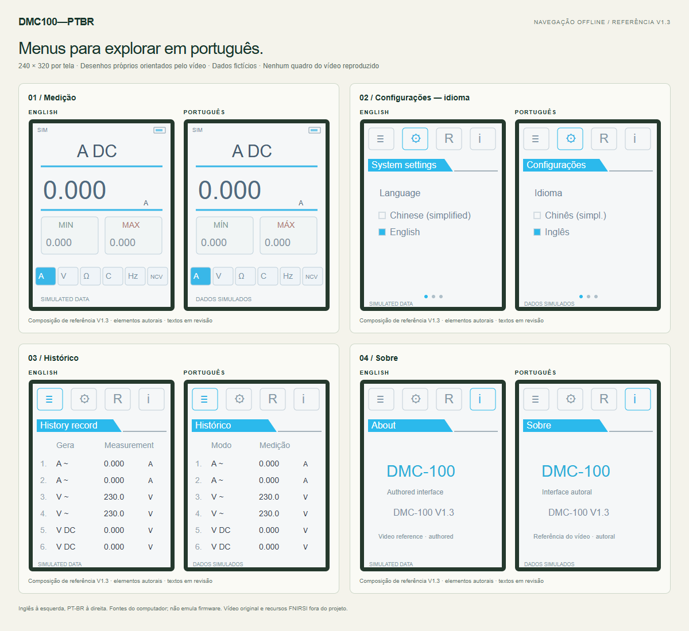

# Referência privada V1.3 e navegação offline

Data: 15/11/2026. Base desta fase: PR #6 (`75a7d24`), empilhado sobre #5. O vídeo e os quadros extraídos permaneceram privados e ignorados pelo Git. Este documento publica somente observações, horários relativos e desenhos autorais. Não inclui nome/caminho do vídeo, dados pessoais, quadros ou leituras reais gravadas.

## Avaliação técnica anterior à implementação

A análise do vídeo foi realizada antes de implementar a nova navegação; a avaliação foi apresentada ao mantenedor na conversa. O simulador é viável com bom grau de fidelidade estrutural, usando uma máquina de estados de interface escrita do zero. A tradução instalável permanece **não demonstrada**: faltam estratégia de glifos/codificação, referências e alocações completas, recursos externos, integridade e compatibilidade de hardware. Nenhuma rotina embarcada foi portada, executada ou alterada.

O PR #5 foi revisto e recomendado para merge apenas no escopo de pesquisa; 27/27 testes locais foram repetidos. O PR #6 concluiu [CI com sucesso](https://github.com/KaioMilano/DMC100-PTBR/actions/runs/43755653156). Nenhum merge foi efetuado. Esta fase é um novo PR separado.

## Método e limites de observação

Referência de aproximadamente 60 segundos, 30 fps, com rotação de apresentação. Foram examinados quadros de toda a duração em intervalos de um segundo, quadros de meio segundo na passagem pelos menus e quadros adicionais de histórico, idioma e Sobre. Os horários abaixo são aproximados; não são medições de debounce ou duração exata de pressão.

Reflexos, movimento, o dedo sobre botões, varredura do LCD e exposição da câmera prejudicam algumas leituras. Mudanças de legibilidade ou uma tela branca momentânea não foram classificadas como mudança de tema ou função. Não foi analisado áudio. Transições fugazes, itens não selecionados e combinações de pressão não demonstradas permanecem em aberto; o inventário cobre os estados estáveis legíveis identificados.

## Telas e sequências identificadas

| Tempo aproximado | Observação no vídeo |
|---|---|
| 00:00–00:03 | Tela escura, acionamento inferior e inicialização com marca. O logotipo não foi reproduzido. |
| 00:04–00:06 | Medição de corrente DC. |
| 00:07–00:16 | Tensão DC; a partir de cerca de 15 s ficam legíveis valor principal, caixas MIN/MAX e navegação inferior. Exposição diferente não comprova outra tela. |
| 00:17–00:18 | Resistência, indicação O.L e unidade. |
| 00:19–00:20 | Capacitância. |
| 00:21 | Frequência (Hz). |
| 00:22–00:23 | LIVE. |
| 00:24–00:27 | Corrente DC e depois AC. |
| 00:28–00:31 | Tensão DC e depois AC. |
| 00:32–00:34 | Resistência e continuidade com símbolo sonoro. |
| 00:35–00:36 | Após interação inferior, transição e histórico em tabela; quatro abas no topo. |
| 00:37 | Configurações, subpágina Language: duas opções, chinesa e English; English selecionado. Três pontos de subpágina no rodapé. |
| 00:38 | Aba Reset: aviso de restaurar configurações, botões Reset e Return. Não foi demonstrada execução da restauração. |
| 00:39–00:40 | Retorno à página de idioma. |
| 00:41–00:42 | Retorno à confirmação Reset. |
| 00:43–00:44 | About, com texto **DMC-100 V1.3** legível. |
| 00:45–00:46 | Histórico novamente. |
| 00:47–00:50 | Continuidade e capacitância. |
| 00:51–00:56 | Frequência e temperatura alternadas. |
| 00:57–00:59 | LIVE, NCV e LIVE. |

Na tabela do histórico, o cabeçalho pouco usual **Gera** foi conferido também no V1.4 em `0x00ADF8`, com NUL. A proposta de tradução é Modo, sujeita a revisão. O simulador usa linhas fictícias, sem copiar as leituras históricas do vídeo.

Botões visíveis: **HOLD** com seta à esquerda, **MODE** com setas opostas, **V-A** com seta à direita, **SAVE/MENU** e botão inferior com símbolo de energia. Não se confirmou um botão separado LIGHT. O vídeo demonstra navegação entre funções/abas, mas não identifica inequivocamente a duração e o efeito de cada pressão em todos os contextos. HOLD congelando valor, salvar curto, limiar de pressão longa, restauração executada e todas as combinações de tecla não foram demonstrados.

## Comparação V1.3 × V1.4

| Item | Vídeo V1.3 | Evidência V1.4 | Conclusão |
|---|---|---|---|
| Identificação | About mostra V1.3 | String de identificação V1.4 da amostra analisada | Diferença de versão confirmada; não prova diferença funcional. |
| Histórico / configurações / Reset / About | Quatro abas e telas visíveis | Textos e seleção de quatro entradas em `ui_draw_main_menu` | Estrutura compatível, não equivalência integral. |
| Idiomas | Duas opções, chinês e inglês | Rotinas/fontes e textos compatíveis com seleção chinesa/inglesa | Nenhuma evidência de PT-BR no firmware. Alternância PT-BR do simulador é autoral. |
| Brilho / °C–°F / desligamento | Não demonstrados; somente pontos de subpágina são visíveis | Rotinas e textos localizados na análise estática | Telas inferidas no modelo; existência e comportamento no V1.3 ainda exigem verificação. |
| Medição e ícones inferiores | Seis grupos e várias variantes observadas | Caminhos de modo V/R/C/H/L/A e rotinas de UI | Correspondência por família; sequência exata e todos os estados pendentes. Diodo no modelo vem da análise estática, não de uma identificação visual inequívoca no vídeo. |
| Cores e layout | Fundo claro, detalhes azuis, MIN/MAX, menu superior | Sem captura executando V1.4; existem famílias de recursos paralelas | Não se pode afirmar mudança de tema entre versões. O antigo protótipo verde era autoral, não captura V1.4. |
| Acentos | Interface exibida em inglês | Nenhuma chave dos acentos PT-BR testados nas tabelas mapeadas | O vídeo não demonstra suporte a português ou Unicode. |

Os nomes de funções da [decompilação comunitária fixada](https://github.com/cakenes/dmc100/tree/1a7684b7a49f1d8bd4a9bab079d578663dda9912) são interpretações. As cautelas de base/offset do [relatório do binário](ANALISE_V14_BINARIO.md) permanecem: base corroborada `0x08007000`, sem confundir rótulos de decompilação com endereço físico.

## Simulador entregue

Abra `simulator/index.html` diretamente no navegador. O laboratório anterior continua em `simulator/lab.html`. O novo renderizador gera SVG de **240 × 320** com composição orientada pelo vídeo: fundo claro, abas superiores, faixa azul, caixas MIN/MAX, seis grupos inferiores e páginas próprias. Nenhum quadro, logotipo, imagem ou fonte proprietária foi incorporado.

Há idioma único inglês/PT-BR ou comparação sincronizada, variantes completa/compacta/sem acentos, fontes 12/16/24/32, zoom, exportação de SVG e catálogo com evidência. O catálogo de navegação estende o anterior para 33 entradas; 16 textos ingleses têm 21 ocorrências com NUL confirmadas (incluindo Gera), enquanto os demais distinguem origem no vídeo, análise estática e rótulos próprios. Nem o inventário nem as traduções estão completos/aprovados para firmware.

O estado é somente memória da página, sem persistência, backend, USB, sensor ou processamento de leituras. Números, MIN/MAX e histórico são fixtures constantes fictícias. Mudar unidade escolhe outra fixture, sem implementar conversão do instrumento. SAVE acrescenta uma fixture; HOLD alterna um indicador; Reset só restaura os valores dessa página após confirmação. Isso não porta lógica de medição ou segurança.

Mapeamento de conveniência: HOLD/← e V-A/→ deslocam no menu; MODE entra/confirma; SAVE sai para medição. Na medição, HOLD alterna indicador, MODE alterna variante e V-A avança grupo. Segurar SAVE abre menu com limiar autoral de 600 ms. O botão energia liga/desliga só o modelo. Cliques nos ícones/pontos e atalhos são recursos do navegador, **não** evidência de touchscreen. Esses mapeamentos devem ser comparados com o aparelho antes de reivindicar equivalência.

O navegador mostra explicitamente quando brilho/unidade/desligamento vêm da análise estática. Seus níveis percentuais de brilho são proposta de interação; os passos reais não foram comprovados. O idioma do navegador não altera as duas opções históricas representadas na tela de idioma. Isso evita inventar uma terceira opção PT-BR como se já existisse no firmware.

## Acentuação e armazenamento

A hipótese “basta usar GBK” não resolve o português: dos 26 caracteres do conjunto `áàâãéêíóôõúüçÁÀÂÃÉÊÍÓÔÕÚÜÇ`, somente oito são representáveis pelo codec GBK do Python: á, à, é, ê, í, ó, ú e ü. Os demais 18, inclusive ã, ç e as maiúsculas testadas, exigem outra convenção. Mesmo os oito representáveis não têm suas chaves nas tabelas examinadas da amostra.

Estratégias futuras, sem implementar nenhuma no firmware nesta fase:

1. Rascunho ASCII com revisão linguística: evita novos glifos, mas perde acentuação e não resolve comprimento/referências.
2. Glifos autorais e chaves de dois bytes: pode aproveitar o caminho de pares, mas exige convenção de codificação, espaço, contagens, ponteiros e revisão do avanço. Pares quadrados podem dobrar a largura de uma letra latina.
3. Decodificador Unicode/fonte própria: resolve repertório de forma mais geral, porém envolve alterações de código, memória e integridade muito além de trocar strings. Não é recomendado sem mapa e revisão independente.

Para 26 glifos adicionais nos tamanhos 12/16/24/32, registros de dois bytes de chave mais bitmap quadrado exigiriam **6.864 bytes**. Em meia largura, a estimativa é **3.848 bytes**. São cálculos hipotéticos, sem alinhamento, índice, ponteiros ou overhead; não indicam RAM/flash livre e não geram fonte ou arquivo instalável. A função `accentBudget()` apenas apresenta essas contas. Fontes do computador e acentos visíveis no navegador não validam o LCD.

## Testes e resultados

Os 20 casos Node passam: incluem os nove anteriores e fluxos de abas, variantes, edição local, retorno, reset com confirmação, imutabilidade, limite de histórico, energia, validação de eventos, orçamento de glifos e renderização. Os 11 testes Playwright/Chrome local passam: seis da bancada anterior e cinco de navegação, com abertura `file://`, ausência de HTTP/erros, idioma, fontes/excessos, exportação, botões, teclado após clique, pressão longa e viewport móvel. Os testes Python anteriores e a CI são mantidos. Resultados remotos finais são vinculados no PR.

Não foram executados testes no equipamento. A amostra do firmware foi somente lida; o vídeo foi decodificado localmente com FFmpeg. Nenhum binário ou mídia privada foi publicado. Imagens deste relatório são produzidas pelo renderizador autoral com `node simulator/tools/export-reference.cjs` (executar preferencialmente a partir da pasta simulator conforme o manual).

## Obstáculos e próxima validação

Confirmar no vídeo adicional ou observação independente: pressões curtas/longas e cada botão em cada contexto, passos de brilho, unidade, desligamento, ordenação exata de variantes, diodo, salvar/retomar histórico e cenários de aviso. Não é necessário atualizar o equipamento para essas observações de interface. Separadamente, completar mapa de strings/recursos, alocações, fontes, revisão de hardware e integridade antes de qualquer proposta de patch. O objetivo atual permanece validar a tradução visual e a navegação, sem firmware instalável.
